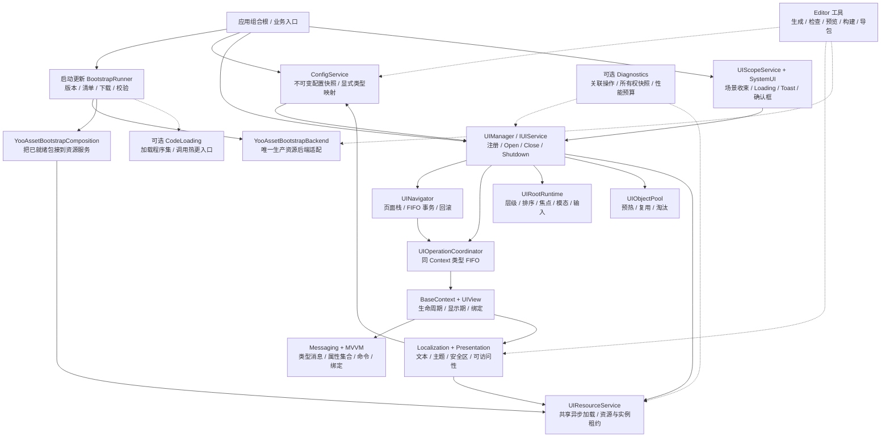
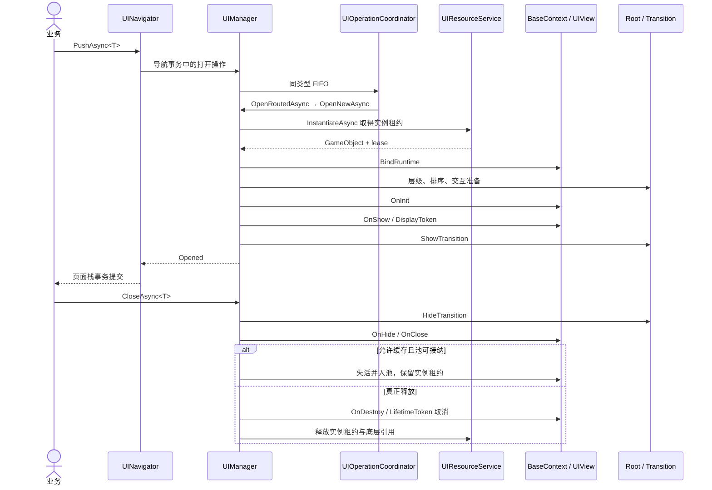
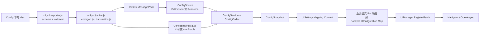
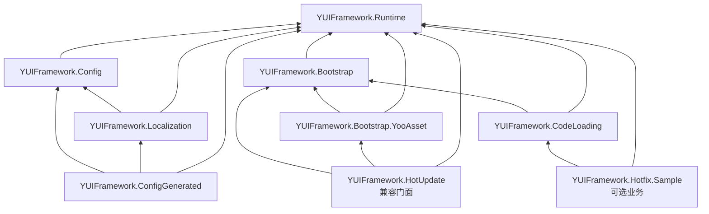

# YUIFramework 框架结构图谱与代码导航

这份图谱回答三个问题：**功能在哪个模块、改动应该从哪个文件进入、模块之间如何协作**。
依据当前维护源码与 `.asmdef` 引用整理，不把历史 P1 示意图当作现行实现。
API 用法见 [PublicAPI](PublicAPI.md)，具体约束以各模块契约文档为准。

文中的代码链接指向**源码仓库布局**；安装 UPM 后的路径换算见第七节。
`Assets\YUIFramework` 是唯一维护的框架实现，导出包不是另一套源码。

## 1. 功能总图

下图箭头表示**调用、配置或协作关系**，不是程序集直接引用；虚线表示可选接入。

应用负责创建和注入服务，不要求业务通过 `UIManager.Instance` 访问全局状态。
`Diagnostics` 是观察者，`SystemUI` 是既有 UI 能力的使用者；它们都不是第二套 UI 内核。
Resources、代码生成视图仍有明确的兼容/最小样例入口，**不是生产 YooAsset 失败时的自动降级**。

## 2. UI 内核：页面打开、生命周期、导航和交互

| 模块 / 功能 | 核心代码在哪里 | 阅读或修改入口 |
|---|---|---|
| 对外服务与注册契约 | [`Runtime\Contracts`](../../Assets/YUIFramework/Runtime/Contracts)；[`UIConfigRegistration.cs`](../../Assets/YUIFramework/Runtime/Core/UIConfigRegistration.cs)、[`UIConfig.cs`](../../Assets/YUIFramework/Runtime/Core/UIConfig.cs) | `IUIService` 汇总服务；`IUIRegistry` 注册；`IUINavigator` 导航；`UIHandle<T>` 防止旧句柄关闭新实例。配置批量注册与 Context 构造校验在 `UIConfigRegistration` |
| 核心调度 | [`UIManager.cs`](../../Assets/YUIFramework/Runtime/Core/UIManager.cs) | `InitializeCore`、`RegisterBatch`、`OpenRoutedAsync`、`OpenNewAsync`、`OpenPooledAsync`、`CloseInternalAsync`、`ShutdownCoreAsync`；活动 Context、实例租约和池归属在这里协调 |
| 并发、取消与重入 | [`UIOperationCoordinator.cs`](../../Assets/YUIFramework/Runtime/Core/UIOperationCoordinator.cs)、[`UIContextOperation.cs`](../../Assets/YUIFramework/Runtime/Contexts/UIContextOperation.cs)、[`UIOperationReentrancyScope.cs`](../../Assets/YUIFramework/Runtime/Core/UIOperationReentrancyScope.cs) | 同类型操作 FIFO、等价首次 Open 的有限合并、调用方/Context/服务取消关联、生命周期回调重入检查 |
| Context 生命周期 | [`BaseContext.cs`](../../Assets/YUIFramework/Runtime/Contexts/BaseContext.cs)、[`UIContextStateMachine.cs`](../../Assets/YUIFramework/Runtime/Contexts/UIContextStateMachine.cs)、[`UIContextStateGraph.cs`](../../Assets/YUIFramework/Runtime/Contexts/UIContextStateGraph.cs) | `HandleInit/Show/Hide/Close/Destroy` 扩展、状态合法迁移、Lifetime/Display token、消息和绑定释放；Page/Dialog/Widget 基类在同目录 |
| GameObject 桥接与控件引用 | [`UIView.cs`](../../Assets/YUIFramework/Runtime/View/UIView.cs)、[`UIRequiredReferenceAttribute.cs`](../../Assets/YUIFramework/Runtime/View/UIRequiredReferenceAttribute.cs) | `UIView` 连接 Context 与实例；生成视图使用序列化控件引用；required 属性供 Editor 检查，不是运行时扫描器 |
| 页面导航 | [`UINavigator.cs`](../../Assets/YUIFramework/Runtime/Navigation/UINavigator.cs)、[`UIPageStackEntry.cs`](../../Assets/YUIFramework/Runtime/Navigation/UIPageStackEntry.cs)、[`UINavigationGuard.cs`](../../Assets/YUIFramework/Runtime/Navigation/UINavigationGuard.cs) | `Push/Pop/Replace/Back/BringToTop`、单事务队列、页面覆盖/恢复、guard 与失败回滚；不是所有 `OpenAsync` 都进入页面栈 |
| 根节点、层级和排序 | [`UIRootRuntime.cs`](../../Assets/YUIFramework/Runtime/Core/UIRootRuntime.cs)、[`UIRoot.cs`](../../Assets/YUIFramework/Runtime/Core/UIRoot.cs)、[`UILayerManager.cs`](../../Assets/YUIFramework/Runtime/Core/UILayerManager.cs)、[`UILayerProfile.cs`](../../Assets/YUIFramework/Runtime/Core/UILayerProfile.cs) | 根/EventSystem 的 owned/external 边界；Canvas、层级配置与排序租约。不要在业务页面另外创建竞争的根或 EventSystem |
| 输入、模态与焦点 | [`UIInputRouter.cs`](../../Assets/YUIFramework/Runtime/Core/UIInputRouter.cs)、[`UIInputArbiter.cs`](../../Assets/YUIFramework/Runtime/Core/UIInputArbiter.cs)、[`UIInputLockService.cs`](../../Assets/YUIFramework/Runtime/Core/UIInputLockService.cs)、[`UIModalService.cs`](../../Assets/YUIFramework/Runtime/Core/UIModalService.cs)、[`UIFocusService.cs`](../../Assets/YUIFramework/Runtime/Core/UIFocusService.cs)、[`UIInteractionController.cs`](../../Assets/YUIFramework/Runtime/Core/UIInteractionController.cs) | Back 路由、场景/UI 输入仲裁、引用计数锁、Popup 栈/遮罩、焦点恢复、可交互状态；与 Navigator 页面栈分开 |

对应契约：[生命周期](Lifecycle.md)、[导航](Navigation.md)、[根与输入](UIRootAndInput.md)。

**当前标准十层**从低到高为：
`Background → Scene → Normal → Fixed → Popup → Guide → Toast → Loading → System → Debug`。
默认 sorting base 为 `0、1000、2000、3000、4000、5000、6000、7000、8000、9000`，
以 `UILayerProfile.CreateDefault()` 为准；旧 `Bottom/Top` 分别归一化为 `Background/Toast`。

## 3. 资源、缓存、启动与代码热更边界

| 模块 / 功能 | 核心代码在哪里 | 职责与边界 |
|---|---|---|
| 资源所有权服务 | [`UIResourceService.cs`](../../Assets/YUIFramework/Runtime/Resource/UIResourceService.cs)、[`IUIResourceService.cs`](../../Assets/YUIFramework/Runtime/Resource/IUIResourceService.cs)、[`UIResourceKey.cs`](../../Assets/YUIFramework/Runtime/Resource/UIResourceKey.cs) | 同 key 共享底层异步加载，每个调用者独立持有 lease；`LoadAssetAsync` 与 `InstantiateAsync` 分开；资源 key 包含包名、地址和类型 |
| 包/Provider 与租约 | [`UIResourcePackageRegistry.cs`](../../Assets/YUIFramework/Runtime/Resource/UIResourcePackageRegistry.cs)、[`IUIResourceProvider.cs`](../../Assets/YUIFramework/Runtime/Resource/IUIResourceProvider.cs)、[`IUIAssetLease.cs`](../../Assets/YUIFramework/Runtime/Resource/IUIAssetLease.cs)、[`IUIInstanceLease.cs`](../../Assets/YUIFramework/Runtime/Resource/IUIInstanceLease.cs) | 注入包适配，管理 native handle、资产引用与实例释放；一个等待者取消不等于取消其他调用者；迟到结果仍须释放 |
| 明确的旧接口/样例资源路径 | [`IResourceLoader.cs`](../../Assets/YUIFramework/Runtime/Resource/IResourceLoader.cs)、[`ResourcesLoader.cs`](../../Assets/YUIFramework/Runtime/Resource/ResourcesLoader.cs)、[`ResourcesResourceProvider.cs`](../../Assets/YUIFramework/Runtime/Resource/ResourcesResourceProvider.cs)、[`CodeViewLoader.cs`](../../Assets/YUIFramework/Examples/CodeViewLoader.cs) | `IResourceLoader` 是兼容/测试适配；Resources 后端显式选择；`CodeViewLoader` 是代码模板样例，不代表生产 Prefab 已经切换到资源租约路径 |
| UI 实例池 | [`UIObjectPool.cs`](../../Assets/YUIFramework/Runtime/Pool/UIObjectPool.cs)、[`UIPoolPolicy.cs`](../../Assets/YUIFramework/Runtime/Pool/UIPoolPolicy.cs)、[`UIPoolingContracts.cs`](../../Assets/YUIFramework/Runtime/Pool/UIPoolingContracts.cs) | 缓存的是初始化后的 Context/视图，处理容量、优先级、闲置淘汰与 Scope；预热调度在 `UIManager.PrewarmAsync/PrewarmRegisteredAsync`，资源预加载不等于实例预热 |
| 资源启动/更新状态机 | [`BootstrapRunner.cs`](../../Assets/YUIFramework/Runtime/Bootstrap/BootstrapRunner.cs)、[`BootstrapProfile.cs`](../../Assets/YUIFramework/Runtime/Bootstrap/BootstrapProfile.cs)、[`BootstrapContracts.cs`](../../Assets/YUIFramework/Runtime/Bootstrap/BootstrapContracts.cs)、[`BootstrapProgressUI.cs`](../../Assets/YUIFramework/Runtime/Bootstrap/BootstrapProgressUI.cs) | 版本/清单/下载/验证/ResourcesReady/可选代码扩展/进入游戏；网络、确认、时间、进度等依赖注入；不是 UI 页面的生命周期状态机 |
| YooAsset 生产适配 | [`YooAssetBootstrapBackend.cs`](../../Assets/YUIFramework/Runtime/Bootstrap.YooAsset/YooAssetBootstrapBackend.cs)、[`YooAssetBootstrapComposition.cs`](../../Assets/YUIFramework/Runtime/Bootstrap.YooAsset/YooAssetBootstrapComposition.cs)、[`YooAssetResourceProvider.cs`](../../Assets/YUIFramework/Runtime/Bootstrap.YooAsset/YooAssetResourceProvider.cs) | 后端负责真实包初始化/更新；Composition 把已经 verified 的包注册为资源 Provider，资源服务借用包，不抢走 Bootstrap 的包所有权 |
| 可选代码加载边界 | [`ResourceHotfixCodeLoader.cs`](../../Assets/YUIFramework/Runtime/CodeLoading/ResourceHotfixCodeLoader.cs)、[`HotfixGameEntry.cs`](../../Assets/YUIFramework/Runtime/CodeLoading/HotfixGameEntry.cs)、[`HotfixContracts.cs`](../../Assets/YUIFramework/Runtime/CodeLoading/HotfixContracts.cs)、[`HotfixAotWitness.cs`](../../Assets/YUIFramework/Runtime/CodeLoading/HotfixAotWitness.cs) | 复用 `IBootstrapCodeLoader/IBootstrapGameEntry`，DLL 资源租约、可信身份/hash、预加载/Mono runtime、具体泛型 witness；不安装 HybridCLR，不保证 stock IL2CPP 可执行下载的 DLL |
| 旧热更新门面 | [`Runtime\HotUpdate`](../../Assets/YUIFramework/Runtime/HotUpdate)，重点 [`LegacyBootstrapRuntime.cs`](../../Assets/YUIFramework/Runtime/HotUpdate/LegacyBootstrapRuntime.cs) | `HotUpdateManager/GameLauncher/YooAssetLoader` 等旧入口转接现有 Bootstrap；不是第二套新更新方案。旧 obsolete API 标注计划 2.1.0 移除 |

对应契约：[资源](Resources.md)、[池](Pooling.md)、[启动](Bootstrap.md)、[AOT/Hotfix](HybridCLRBoundary.md)。

## 4. 数据、表现、列表、场景与诊断

| 模块 / 功能 | 核心代码在哪里 | 职责与扩展位置 |
|---|---|---|
| 配置运行时 | [`ConfigService.cs`](../../Assets/YUIFramework/Config/ConfigService.cs)、[`ConfigContracts.cs`](../../Assets/YUIFramework/Config/ConfigContracts.cs)、[`ConfigCodec.cs`](../../Assets/YUIFramework/Config/ConfigCodec.cs)、[`ResourceConfigSource.cs`](../../Assets/YUIFramework/Config/ResourceConfigSource.cs)、[`ConfigUIStartup.cs`](../../Assets/YUIFramework/Config/ConfigUIStartup.cs) | JSON/MessagePack 解码、强类型不可变 snapshot、原子发布/重载、租约所有权；Config 加载→显式映射→批量注册→业务入口 |
| 配置生成与类型映射 | [`Config\src`](../../Config/src)、[`ConfigBindings.g.cs`](../../Assets/YUIFramework/Examples/ConfigGenerated/ConfigBindings.g.cs)、[`UISettingsMapping.cs`](../../Assets/YUIFramework/Examples/ConfigGenerated/UISettingsMapping.cs)、[`SampleUIConfiguration.cs`](../../Assets/YUIFramework/Examples/SampleUIConfiguration.cs) | Excel 校验/事务导出/强类型生成；row 转 UIConfig 与 row 到具体 Context 的显式映射分开；不通过扫描业务类型自动注册 |
| 类型消息 | [`UIMessageCenter.cs`](../../Assets/YUIFramework/Runtime/Messaging/UIMessageCenter.cs)、[`UIMessageTopic.cs`](../../Assets/YUIFramework/Runtime/Messaging/UIMessageTopic.cs)、[`UIMessageScope.cs`](../../Assets/YUIFramework/Runtime/Messaging/UIMessageScope.cs) | payload 类型约束、订阅 owner/handler、稳定派发与异常；Context 的 Lifetime/Display 订阅辅助函数在 `BaseContext` |
| MVVM、命令、集合与绑定 | [`ViewModelBase.cs`](../../Assets/YUIFramework/Runtime/MVVM/ViewModelBase.cs)、[`ObservableProperty.cs`](../../Assets/YUIFramework/Runtime/MVVM/ObservableProperty.cs)、[`ObservableCollection.cs`](../../Assets/YUIFramework/Runtime/MVVM/ObservableCollection.cs)、[`UICommand.cs`](../../Assets/YUIFramework/Runtime/MVVM/UICommand.cs)、[`UIDataBinding.cs`](../../Assets/YUIFramework/Runtime/MVVM/UIDataBinding.cs)、[`Validation.cs`](../../Assets/YUIFramework/Runtime/MVVM/Validation.cs) | owned/external VM、双向绑定、验证、同步 `UICommand` 与异步 `UIAsyncCommand`；按事件更新，不每帧反射读取属性 |
| 文本本地化 | [`TextLocalizationService.cs`](../../Assets/YUIFramework/Localization/TextLocalizationService.cs)、[`LocalizationTextCatalog.cs`](../../Assets/YUIFramework/Localization/LocalizationTextCatalog.cs)、[`ConfigLocalizedText.cs`](../../Assets/YUIFramework/Localization/ConfigLocalizedText.cs)、[`LocalizationFormatting.cs`](../../Assets/YUIFramework/Localization/LocalizationFormatting.cs) | 借用 Config、locale/fallback、key 查询、Text/TMP 绑定、格式化/RTL 扩展；并非另一份全局配置库 |
| 主题与可访问性 | [`UIPresentationService.cs`](../../Assets/YUIFramework/Localization/UIPresentationService.cs)、[`UIPresentationCatalog.cs`](../../Assets/YUIFramework/Localization/UIPresentationCatalog.cs)、[`ConfigPresentationBinding.cs`](../../Assets/YUIFramework/Localization/ConfigPresentationBinding.cs)、[`UIAccessibilitySemantics.cs`](../../Assets/YUIFramework/Localization/UIAccessibilitySemantics.cs) | 颜色/font/sprite/material token、按显示期持有的资产租约、字体缩放/高对比/减少动画/语义 |
| 屏幕、安全区与键盘区域 | [`UIScreenLayout.cs`](../../Assets/YUIFramework/Runtime/Layout/UIScreenLayout.cs)、[`UISafeAreaContent.cs`](../../Assets/YUIFramework/Runtime/Layout/UISafeAreaContent.cs) | 采样分辨率/安全区/键盘并驱动布局；安全区作用于内容，不挤压整个层根或模态遮罩 |
| 转场 | [`UITransitionRunner.cs`](../../Assets/YUIFramework/Runtime/Transitions/UITransitionRunner.cs)、[`UITransitionContracts.cs`](../../Assets/YUIFramework/Runtime/Transitions/UITransitionContracts.cs)、[`IUITransition.cs`](../../Assets/YUIFramework/Runtime/Transitions/IUITransition.cs) | Fade/Scale/Slide、自定义注册、单 writer、基线恢复/反向/取消、reduced-motion；不要另写并行动画争用同一属性 |
| 列表公共层与兼容入口 | [`Runtime\VirtualList`](../../Assets/YUIFramework/Runtime/VirtualList)，重点 [`UIListDataSource.cs`](../../Assets/YUIFramework/Runtime/VirtualList/UIListDataSource.cs)、[`UIListItemLifetime.cs`](../../Assets/YUIFramework/Runtime/VirtualList/UIListItemLifetime.cs)、[`UINestedScrollRect.cs`](../../Assets/YUIFramework/Runtime/VirtualList/UINestedScrollRect.cs)、[`UIVirtualList.cs`](../../Assets/YUIFramework/Runtime/VirtualList/UIVirtualList.cs) | 稳定数据/项生命周期/嵌套滚动契约；旧 `UIVirtualList` 通过 driver factory 转接，不含另一套独立虚拟化内核 |
| 可选商业列表实现 | [`Integrations\SuperScrollView~\Runtime`](../../Integrations/SuperScrollView~/Runtime)，重点 [`SuperScrollViewList.cs`](../../Integrations/SuperScrollView~/Runtime/SuperScrollViewList.cs)、[`SuperScrollViewLifetime.cs`](../../Integrations/SuperScrollView~/Runtime/SuperScrollViewLifetime.cs)、[`LegacyListDriver.cs`](../../Integrations/SuperScrollView~/Runtime/LegacyListDriver.cs) | 合法本地安装后提供纵横列表/Grid/动态尺寸、生命周期与旧入口适配；不随私有 UPM 导出商业插件；完整 RC 样例的有限列表不代表此实现 |
| UI 生命周期 Scope | [`UIScopeService.cs`](../../Assets/YUIFramework/Runtime/Scopes/UIScopeService.cs)、[`UIManager.Scopes.cs`](../../Assets/YUIFramework/Runtime/Core/UIManager.Scopes.cs) | Global/Scene/Module；真实 scene handle、场景切换事件、所属操作取消、导航剪枝、活动/隐藏 UI 与 idle pool 收束 |
| 系统覆盖层 | [`UILoadingService.cs`](../../Assets/YUIFramework/Runtime/SystemUI/UILoadingService.cs)、[`UIToastService.cs`](../../Assets/YUIFramework/Runtime/SystemUI/UIToastService.cs)、[`UIConfirmationService.cs`](../../Assets/YUIFramework/Runtime/SystemUI/UIConfirmationService.cs) | 引用计数 Loading/进度、有限队列与合并/优先级/限流、FIFO 确认框；`UISystemUIService<T>` 断线/维护/强更策略也在确认框文件中，不含实际网络/商店逻辑 |
| 操作、所有权与性能诊断 | [`UIDiagnostics.cs`](../../Assets/YUIFramework/Runtime/Diagnostics/UIDiagnostics.cs)、[`UIDiagnosticInspection.cs`](../../Assets/YUIFramework/Runtime/Diagnostics/UIDiagnosticInspection.cs)、[`UIPerformanceDiagnostics.cs`](../../Assets/YUIFramework/Runtime/Diagnostics/UIPerformanceDiagnostics.cs)、[`UIManager.Diagnostics.cs`](../../Assets/YUIFramework/Runtime/Core/UIManager.Diagnostics.cs) | 有界关联事件/span、主动快照、实际重复订阅/结束 owner 残留/超时检查、adapter 隔离；`UIProfilerSampler` 与目标预算/报告在性能文件中，Unavailable 不伪装成 0 |

深入文档：[配置](Config.md)、[消息](Messaging.md)、[MVVM](MVVM.md)、[本地化](Localization.md)、
[表现](Presentation.md)、[转场](Transitions.md)、[列表](Virtualization.md)、[场景与系统 UI](SystemUI.md)、[诊断](Diagnostics.md)。

## 5. 两条核心运行链路

### 5.1 打开与关闭页面

以下画的是**新建实例、资源服务路径的成功主线**。已有活动实例、池复用、
失败/取消回滚由 `OpenRoutedAsync` 分流；不是每次 Open 都重新加载或 OnInit。

取消 Close 可能回滚到 `Opened`，不能提前当成已经结束显示期。
Lifetime 贯穿实例，Display 只覆盖实际显示周期；池化不等于销毁。
`UIScope.ReleaseAsync()` 收束活动 UI 和任务；旧 `ReleaseScopeAsync(UIPoolScope)`
只淘汰 idle 池并禁止后续返池，**两者不能互换**。

外层组合根还负责反向释放依赖：先停止/等待其启动任务和 UI，之后释放自有的
Presentation/Text、Config、资源服务，最后关闭拥有底层包的 Bootstrap。
被注入/借用的全局服务不能由某个页面擅自 Shutdown；正常 idle 池引用也不能直接判成泄漏。

### 5.2 Excel 配置如何变成页面注册

`Config\src` 中：`ui-schema.js / localization-schema.js / presentation-schema.js`
处理表约束；`codegen.js` 生成类型；`transaction.js` 负责多目录提交/回滚；
`unity-pipeline.js` 统一客户端产物和 Unity 同步。默认生成位置虽在
`Examples\ConfigGenerated`，它属于独立的 `YUIFramework.ConfigGenerated` 程序集，
不是业务 Example 程序集。`UISettingsMapping.cs` 是手写映射，不应混入 `.g.cs`。

资源启动的关键边界则是：
`BootstrapRunner → 后端清单验证 → ResourcesReady → IBootstrapCodeLoader → IBootstrapGameEntry`。
应用可在入口中创建 `YooAssetBootstrapComposition`，将已就绪包提供给 UI/Config；
Bootstrap 不静态依赖尚未加载的具体 Hotfix 业务程序集。

## 6. 程序集依赖图

**箭头为 `.asmdef` 中真实的直接引用：使用方 → 被引用方**。
为便于阅读只列核心项目程序集，省略 Unity/UniTask/YooAsset 等外部程序集，
以及 Examples、Editor 和 Tests 的完整引用边；这不是上一节运行时调用图。

- `Runtime` 不引用具体业务、Editor、YooAsset 或 HybridCLR；生产 SDK 被隔离在适配程序集。
- `Config`、`Localization` 是独立程序集；`Runtime` 的功能文件夹并不各有一个 asmdef。
- `Editor`、`Config.Editor`、`Localization.Editor` 均显式 `includePlatforms: ["Editor"]`；
  不能仅凭目录名认定程序集不会进入 Player。
- `Hotfix.Sample` 只依赖公共 Runtime/CodeLoading 契约及必要外部库；
  `Samples\HotfixAot` 是 AOT 侧边界演示，不是正式 HybridCLR 工具链。
- 可选 `YUIFramework.SuperScrollView` 依赖 `Runtime` 与本地商业 `SuperScrollView`；
  无合法本地安装时不应让核心框架依赖它。

## 7. Editor、包目录与实际运行入口

| 工作 | 代码入口 | 输出或用途 |
|---|---|---|
| 页面/VM/序列化引用生成 | [`UIPageGenerator.cs`](../../Assets/YUIFramework/Editor/UIPageGenerator.cs) | 有所有权标记的 generated 文件、首次手写 partial、追加 Excel 行；幂等与事务回滚 |
| Prefab/资源/导航关系检查 | [`UIAssetValidator.cs`](../../Assets/YUIFramework/Editor/UIAssetValidator.cs)、[`UIEditorToolingWindow.cs`](../../Assets/YUIFramework/Editor/UIEditorToolingWindow.cs) | 显式 scope 的检查报告、可定位对象、已登记导航和真实资源依赖图；不静态推断任意业务跳转 |
| 构建策略与前置门禁 | [`UIBuildProfile.cs`](../../Assets/YUIFramework/Editor/UIBuildProfile.cs)、[`UIBuildGate.cs`](../../Assets/YUIFramework/Editor/UIBuildGate.cs)、[`UIBuildWorkspace.cs`](../../Assets/YUIFramework/Editor/UIBuildWorkspace.cs) | MinimalDemo/Production、同一验证器的 preprocess/批处理、隔离工作区；`UIExternalOutputs` 也在 `UIBuildGate.cs` |
| YooAsset 构建/报告/保留规则 | [`UIYooAssetBuilder.cs`](../../Assets/YUIFramework/Editor/UIYooAssetBuilder.cs)、[`UIYooAssetLinker.cs`](../../Assets/YUIFramework/Editor/UIYooAssetLinker.cs) | 官方 builder、版本/history、builtin catalog；核心反射文件系统构造函数的 UnityLinker callback |
| 语言/主题/设备预览与内容检查 | [`Localization\Editor`](../../Assets/YUIFramework/Localization/Editor)，重点 `UIDevicePreview.cs`、`UIEditorPresentationPreview.cs`、`UIContentChecks.cs`、`TransientTMPFonts.cs` | 实际 Config/字体/图像/材质预览、临时字体隔离、key drawer；不修改源字体图集或全局 TMP 设置 |
| 包导出与校验 | [`UIPackageExporter.cs`](../../Assets/YUIFramework/Editor/UIPackageExporter.cs)、[`Distribution\package.json`](../../Distribution/package.json) | 源码→UPM、确定性 metadata、SHA 清单、严格 Verify；不发布、不包含商业 local 或用户动态字体 |
| RC 工作区/构建/平台检查 | [`ReleaseCandidateTools.cs`](../../Assets/YUIFramework/Editor/ReleaseCandidateTools.cs)、[`HotfixBoundaryTools.cs`](../../Assets/YUIFramework/Editor/HotfixBoundaryTools.cs) | 完整样例工作区、真实官方资源/Player 构建、移动端 preflight、裁剪探针；不是已通过真机或 iOS 门禁的证明 |

### 维护源码与导出包的路径换算

| 仓库内单一维护源 | UPM 内位置 |
|---|---|
| `Assets\YUIFramework\Runtime` | `Runtime` |
| `Assets\YUIFramework\Config` | `Runtime\Configuration` |
| `Assets\YUIFramework\Localization` | `Runtime\Localization` |
| `Assets\YUIFramework\Examples\ConfigGenerated` | `Runtime\ConfigGenerated` |
| `Assets\YUIFramework\Editor` | `Editor` |
| `Assets\YUIFramework\PackageTests` | `Tests` |
| `Examples`（不含 ConfigGenerated）、`Samples`、`Hotfix.Sample`、指定样例数据/测试 | `Samples~\Complete` |
| `Documentation\Y2.0` | `Documentation~` |
| `Config` 下受选的源码/表格/测试/工具 | `Tools~\Config` |
| `Assets\YUIFramework\Tests` 完整仓库回归 | 不整体导出；指定完整流程测试随样例导出 |
| `Assets\Script` 游戏代码、`Integrations\SuperScrollView~` 可选适配 | 不随核心包导出 |

`Samples~` 必须真实 Import 到消费工程 Assets 后才编译；非 embedded 包测试需要
消费工程 `manifest.testables`。包内普通 `link.xml` 不能直接视作 Unity 2022.3 的
应用裁剪根：核心使用 `UIYooAssetLinker`，可选 Hotfix 规则随样例 Import 到 Assets。
新增文档不会自动重写过去的验收包/清单；重导出流程见 [PackageQuickstart](PackageQuickstart.md)。

### 运行哪个入口

| 想看什么 | 入口与代码 | 注意 |
|---|---|---|
| 当前游戏封面/主菜单 | [`LoadScene.unity`](../../Assets/Scenes/LoadScene.unity) → [`GaneBootstrap.cs`](../../Assets/Script/GaneBootstrap.cs) 中的 **GameBootstrap** → [`LoginCoverPageContext.cs`](../../Assets/Script/Page/LoginCoverPageContext.cs) / [`MainMenuPageContext.cs`](../../Assets/Script/Page/MainMenuPageContext.cs) | 文件名实际拼写是 `GaneBootstrap.cs`；封面视图在 `LoginCoverView.cs`，资源在 `Assets\Resources\UI\Pages`。这是游戏层，不是框架生产资源入口 |
| 最小实例化服务/Hello | [`Y2ServiceBootstrap.cs`](../../Assets/YUIFramework/Examples/Y2ServiceBootstrap.cs)、[`HelloUIBootstrap.cs`](../../Assets/YUIFramework/Examples/HelloUIBootstrap.cs) | 组合 Config、注册和代码视图；服务由该入口负责清理 |
| 完整启动与 UI 流程 | [`ReleaseCandidateSample.cs`](../../Assets/YUIFramework/Examples/ReleaseCandidateSample.cs)、[`ReleaseCandidateFlow.cs`](../../Assets/YUIFramework/Examples/ReleaseCandidateFlow.cs) | 真 Bootstrap/marker + 代码 UI，导航/Popup/MVVM/有限列表/本地化/场景切换；不是 CDN 更新或商业虚拟列表认证 |
| Loading/Toast/场景/确认框 | [`SystemUISample.cs`](../../Assets/YUIFramework/Examples/SystemUISample.cs)、[`SystemUISampleDriver.cs`](../../Assets/YUIFramework/Examples/SystemUISampleDriver.cs)、[`SystemUISampleViews.cs`](../../Assets/YUIFramework/Examples/SystemUISampleViews.cs) | 实际视图与服务如何接线 |
| 调试面板/性能预算 | [`UIDiagnosticsSample.cs`](../../Assets/YUIFramework/Examples/UIDiagnosticsSample.cs)、[`UIDiagnosticsPanelContext.cs`](../../Assets/YUIFramework/Examples/UIDiagnosticsPanelContext.cs) | Dev/Editor gate、手动刷新/filter/details；不等于全局常驻采样 |
| MVVM/列表/表现单项 | [`MvvmSamplePage.cs`](../../Assets/YUIFramework/Examples/MvvmSamplePage.cs)、[`MvvmSampleViewModel.cs`](../../Assets/YUIFramework/Examples/MvvmSampleViewModel.cs)、[`VirtualListSamplePage.cs`](../../Assets/YUIFramework/Examples/VirtualListSamplePage.cs)、[`PresentationSampleView.cs`](../../Assets/YUIFramework/Examples/PresentationSampleView.cs) | 旧虚拟列表样例需要可选后端；表现样例需显式创建应用自有字体等资源 |
| AOT 与未来 Hotfix 接口 | [`HotfixBoundarySample.cs`](../../Assets/YUIFramework/Samples/HotfixAot/HotfixBoundarySample.cs)、[`HotfixSampleEntry.cs`](../../Assets/YUIFramework/Hotfix.Sample/HotfixSampleEntry.cs) | AOT 启动与业务程序集分离；保留规则、具体泛型 witness 与未来补充元数据分别说明 |

这些启动样例都是独立组合根，**不要在同一运行场景同时挂多个入口争抢 UIRoot/EventSystem**。

## 8. 修改功能时去哪里找回归

除另行标注外，以下测试位于 `Assets\YUIFramework\Tests`；列出代表性文件，
不是声称仅这些测试即可完成一次发布验收。

| 修改点 | 对应测试代码 |
|---|---|
| 生命周期/并发/导航/根输入 | `PlayMode\UIManagerCharacterizationTests.cs`、`UIOperationCoordinatorCharacterizationTests.cs`、`UINavigatorTransactionCharacterizationTests.cs`、`UIRootAndInputPlayModeTests.cs`；`EditMode\UIRootAndLayerEditModeTests.cs` |
| 资源、池、Bootstrap | Edit/Play 的 `ResourceOwnership*`、`PoolingGovernance*`；`PlayMode\UIManagerResourceOwnershipPlayModeTests.cs`；Edit 的 `BootstrapCoreEditModeTests.cs`、`BootstrapRunnerEditModeTests.cs`、`YooAssetBootstrapAdapterEditModeTests.cs` |
| Config/消息/MVVM/列表 | Edit/Play 的 `ConfigIntegration*`；`EditMode\Stage9MessagingMvvmEditModeTests.cs`、`Stage10ListContractsTests.cs`；`PlayMode\Stage9BindingsLifecyclePlayModeTests.cs`；可选列表实现在 `Integrations\SuperScrollView~\Tests` |
| 本地化/主题/转场 | Edit/Play 的 `TextLocalization*`、`Stage11Presentation*`；`PlayMode\Phase8TransitionsPlayModeTests.cs` |
| Scope/系统 UI/诊断 | Edit/Play 的 `Stage12SystemUI*`、`Stage13Diagnostics*` |
| Editor 生成/资源门禁/预览 | `EditMode\Stage14EditorToolingTests.cs`、`Stage14AuthoringIntegrationTests.cs`；部分真实构建/渲染用例为 Explicit，需独立环境 |
| Hotfix/包化/完整流程 | `EditMode\Stage15BoundaryEditModeTests.cs`、`Stage16PackagingTests.cs`；Play 的 `Stage15Hotfix*`、`Stage16CompleteFlowTests.cs`；`Assets\YUIFramework\PackageTests`；`Distribution\SampleTests` |
| Excel 导出工具 | [`Config\test`](../../Config/test)，与运行时 C# 测试分开 |
| 游戏封面 | [`Assets\Tests\LoginCover`](../../Assets/Tests/LoginCover)，与框架包测试分开 |

排错顺序建议：**入口/注册配置 → Navigator 与类型队列 → Context 状态/显示期 →
资源租约/池 → 根交互/转场 → 诊断快照**。按症状定位见 [Troubleshooting](Troubleshooting.md)。
实际执行证据与移动端未通过项见 [Testing](Testing.md)、[ReleaseCandidate](ReleaseCandidate.md)；
这份结构图谱不新增任何性能、真机、HybridCLR 或发布认证结论。
